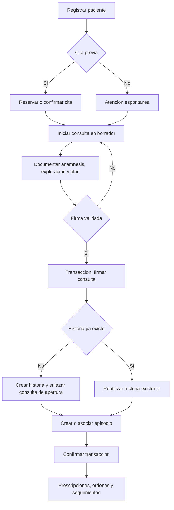
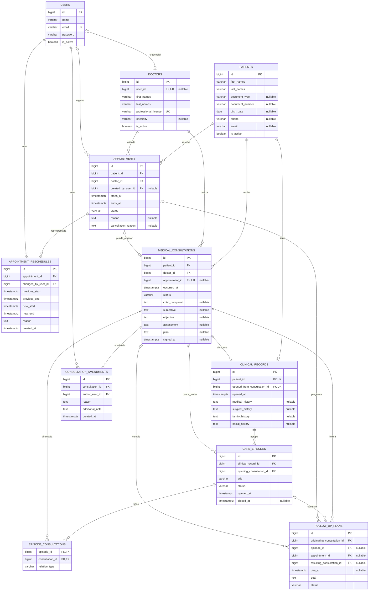
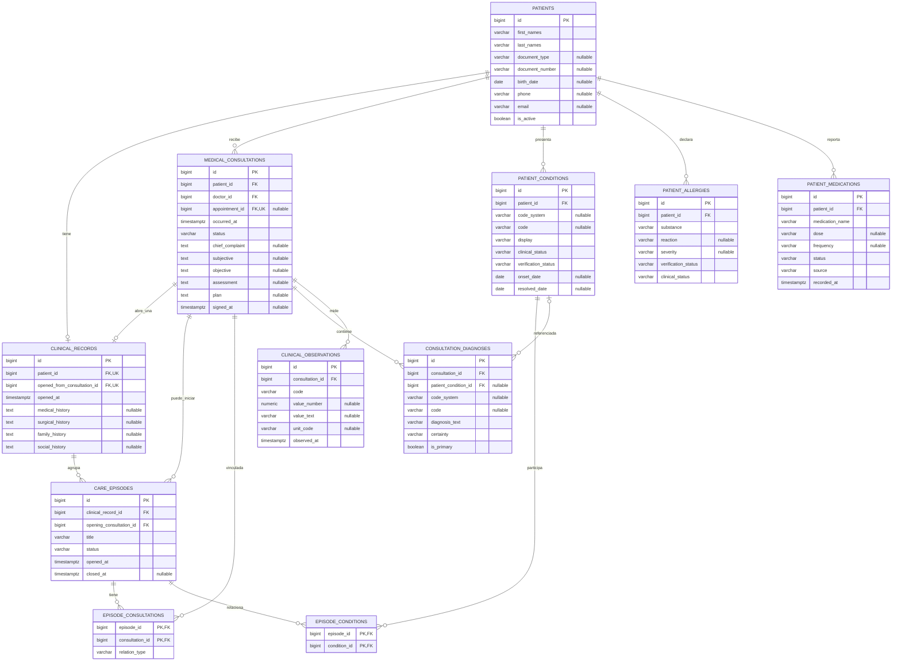
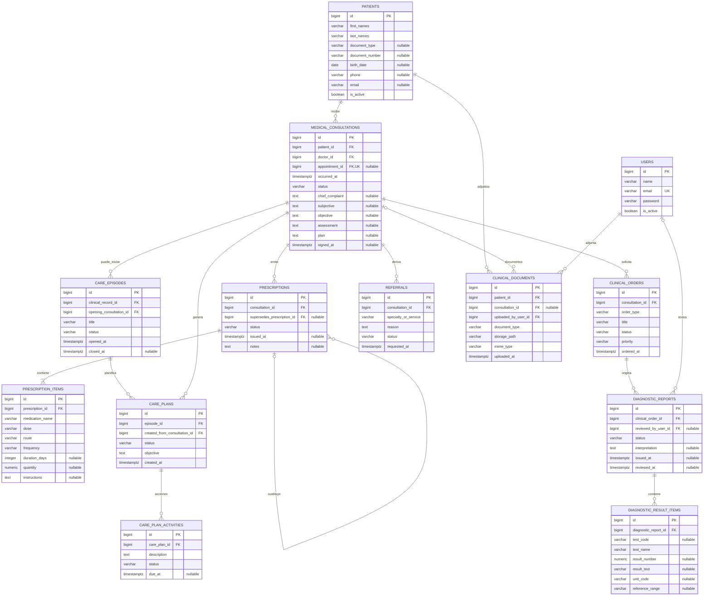
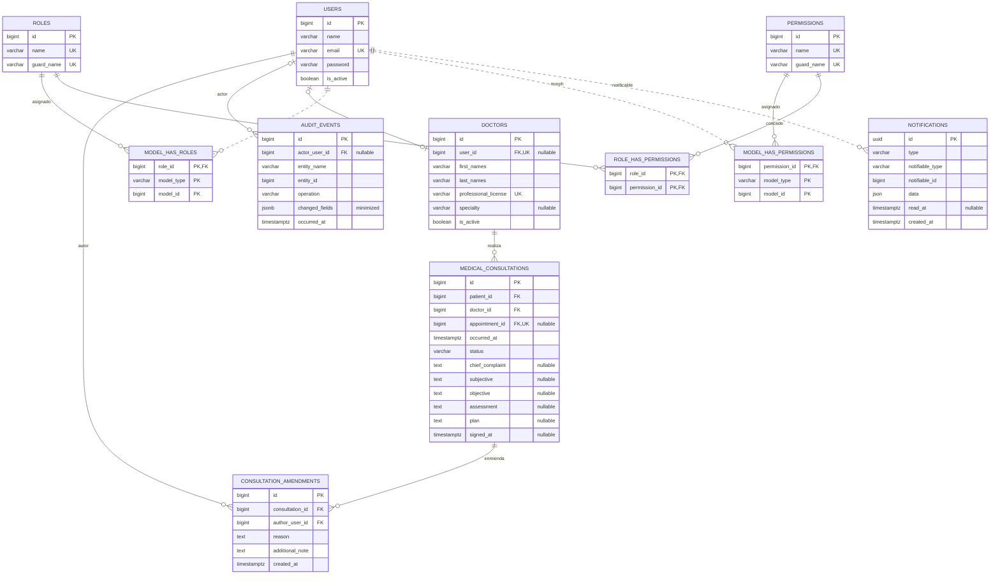

# SIGCM — Modelo entidad–relación completo (propuesta v2)

**Sistema:** Gestión integral de consultas médicas · **Base de datos:** PostgreSQL 17 · **Notación lógica:** Mermaid ERD.  
**Estado:** propuesta para revisión; no existen migraciones ni tablas implementadas.  
**Alcance:** consultas ambulatorias en un centro médico, con extensión clínica opcional. La [notación conceptual Peter Chen](./diagramas/sigcm-chen-conceptual-v1.svg) describe los cinco dominios principales, no todas las tablas técnicas.

## 1. Principios y flujo clínico

1. Un paciente puede registrarse y reservar una cita **sin historia clínica**.
2. La **primera consulta** se registra en borrador; al **firmarse**, una transacción abre exactamente una historia clínica longitudinal por paciente, con referencia a esa consulta (0..1 en el paciente, 1..1 en la historia).
3. La historia puede contener **varios episodios**, cada uno agrupa consultas relacionadas. Una consulta puede pertenecer a **varios episodios** mediante `episode_consultations`.
4. El **seguimiento planificado** (`follow_up_plans`) no equivale a la **consulta de seguimiento** (`medical_consultations`), que es una atención nueva y mantiene su propia firma.
5. **Prescripción** es la orden emitida durante una consulta; **enmienda** es una corrección documental de una consulta firmada. Una prescripción reemplazada mantiene referencia a la anterior.
6. La auditoría de cambios confirmados reside en `audit_events`, con triggers propios de PostgreSQL; no se usan paquetes Laravel de auditoría.

### Flujo de alta inicial

> Las etapas de firma, apertura y vínculo de episodio se consideran una operación **atómica**. Para el paciente sin historia no se ejecuta el alta del expediente durante el registro administrativo.

## 2. ER maestro — relaciones de las 33 tablas

Diagrama integrado, simplificado **solo en atributos** para mantener legible la topología. Las secciones 3–6 muestran todas las columnas principales con sus PK/FK.

```mermaid
erDiagram
    PATIENTS ||--o| CLINICAL_RECORDS : tiene
    PATIENTS ||--o{ APPOINTMENTS : reserva
    DOCTORS ||--o{ APPOINTMENTS : atiende
    USERS o|--o{ APPOINTMENTS : registra
    APPOINTMENTS ||--o{ APPOINTMENT_RESCHEDULES : reprogramada
    USERS ||--o{ APPOINTMENT_RESCHEDULES : autor
    PATIENTS ||--o{ MEDICAL_CONSULTATIONS : recibe
    DOCTORS ||--o{ MEDICAL_CONSULTATIONS : realiza
    APPOINTMENTS o|--o| MEDICAL_CONSULTATIONS : puede_originar
    MEDICAL_CONSULTATIONS ||--o| CLINICAL_RECORDS : abre_una
    CLINICAL_RECORDS ||--o{ CARE_EPISODES : agrupa
    MEDICAL_CONSULTATIONS ||--o{ CARE_EPISODES : puede_iniciar
    CARE_EPISODES ||--o{ EPISODE_CONSULTATIONS : tiene
    MEDICAL_CONSULTATIONS ||--o{ EPISODE_CONSULTATIONS : vinculada
    MEDICAL_CONSULTATIONS ||--o{ FOLLOW_UP_PLANS : indica
    CARE_EPISODES o|--o{ FOLLOW_UP_PLANS : contexto
    APPOINTMENTS o|--o{ FOLLOW_UP_PLANS : programa
    MEDICAL_CONSULTATIONS o|--o{ FOLLOW_UP_PLANS : cumple
    PATIENTS ||--o{ PATIENT_CONDITIONS : presenta
    PATIENTS ||--o{ PATIENT_ALLERGIES : declara
    PATIENTS ||--o{ PATIENT_MEDICATIONS : reporta
    CARE_EPISODES ||--o{ EPISODE_CONDITIONS : relaciona
    PATIENT_CONDITIONS ||--o{ EPISODE_CONDITIONS : participa
    MEDICAL_CONSULTATIONS ||--o{ CONSULTATION_DIAGNOSES : contiene
    PATIENT_CONDITIONS o|--o{ CONSULTATION_DIAGNOSES : referenciada
    MEDICAL_CONSULTATIONS ||--o{ CLINICAL_OBSERVATIONS : mide
    MEDICAL_CONSULTATIONS ||--o{ PRESCRIPTIONS : emite
    PRESCRIPTIONS ||--|{ PRESCRIPTION_ITEMS : contiene
    PRESCRIPTIONS o|--o{ PRESCRIPTIONS : sustituye
    MEDICAL_CONSULTATIONS ||--o{ CLINICAL_ORDERS : solicita
    CLINICAL_ORDERS ||--o{ DIAGNOSTIC_REPORTS : origina
    DIAGNOSTIC_REPORTS ||--o{ DIAGNOSTIC_RESULT_ITEMS : contiene
    USERS o|--o{ DIAGNOSTIC_REPORTS : revisa
    MEDICAL_CONSULTATIONS ||--o{ REFERRALS : deriva
    PATIENTS ||--o{ CLINICAL_DOCUMENTS : adjuntos
    MEDICAL_CONSULTATIONS o|--o{ CLINICAL_DOCUMENTS : documentos
    USERS ||--o{ CLINICAL_DOCUMENTS : adjunta
    CARE_EPISODES ||--o{ CARE_PLANS : planifica
    MEDICAL_CONSULTATIONS ||--o{ CARE_PLANS : genera
    CARE_PLANS ||--o{ CARE_PLAN_ACTIVITIES : acciones
    MEDICAL_CONSULTATIONS ||--o{ CONSULTATION_AMENDMENTS : enmienda
    USERS ||--o{ CONSULTATION_AMENDMENTS : autor
    USERS o|--o{ AUDIT_EVENTS : actor
    USERS o|--o| DOCTORS : credencial
    ROLES ||--o{ MODEL_HAS_ROLES : asignado
    USERS ||..o{ MODEL_HAS_ROLES : morph
    PERMISSIONS ||--o{ MODEL_HAS_PERMISSIONS : asignado
    USERS ||..o{ MODEL_HAS_PERMISSIONS : morph
    ROLES ||--o{ ROLE_HAS_PERMISSIONS : incluye
    PERMISSIONS ||--o{ ROLE_HAS_PERMISSIONS : concede
    USERS ||..o{ NOTIFICATIONS : notificable
```

## 3. Identidad, agenda, historia y seguimientos

**Relaciones clave:** `clinical_records.patient_id` es único; `opened_from_consultation_id` es FK única y obligatoria. La consulta de apertura debe estar firmada y pertenecer al mismo paciente. Una cita es opcional en la consulta, por lo que la atención espontánea no necesita crear una cita ficticia.

## 4. Antecedentes, condiciones, diagnósticos y mediciones

**Regla:** `patient_conditions` describe problemas longitudinales; `consultation_diagnoses` documenta diagnósticos de una visita. Los medicamentos habituales, alergias y observaciones clínicas no se deben comprimir en un único campo de texto libre como fuente principal. Los códigos de terminología y unidades se conservan como datos opcionales, no como catálogos obligatorios del MVP.

## 5. Prescripciones, órdenes, resultados y planes de atención

**Reglas:** `prescription_items` detalla las indicaciones; `supersedes_prescription_id` enlaza prescripciones sustituidas, sin sobrescribir la orden firmada. La recepción de un informe no significa automáticamente que el médico lo haya revisado: se registra `reviewed_at` con su responsable. Un informe puede contener varios resultados.

## 6. Filament Shield/Spatie, notificaciones y auditoría

- **Spatie/Shield:** cinco tablas estándar: `roles`, `permissions`, `role_has_permissions`, `model_has_roles`, `model_has_permissions`. No crear `users.role_id` ni duplicar las migraciones del paquete. Se presupone `teams=false` y un guard compatible.
- **Polimorfismo:** las líneas punteadas `USERS` → `MODEL_HAS_*` y `USERS` → `NOTIFICATIONS` son referencias lógicas mediante `model_type/model_id` o `notifiable_type/notifiable_id`; **no son FK físicas** en PostgreSQL.
- **Laravel Notifications:** `notifications.id` es UUID, `data` es JSON y `read_at` permite distinguir notificaciones leídas; la tabla se usa para avisos persistentes y no determina por sí sola permisos clínicos.
- **Auditoría:** `audit_events` registra cambios confirmados mediante triggers, con actor identificado desde contexto transaccional validado, mínimo de metadatos y sin replicar notas clínicas completas. Un trigger de DML **no audita consultas SELECT**.

## 7. Inventario de tablas y prioridades

| Dominio | Tablas | Prioridad de diseño |
|---|---|---|
| Pacientes y personal | `patients`, `doctors`, `users` | Núcleo |
| Agenda | `appointments`, `appointment_reschedules` | Núcleo / extensión |
| Historial y continuidad | `clinical_records`, `medical_consultations`, `care_episodes`, `episode_consultations`, `episode_conditions`, `follow_up_plans` | Núcleo ampliado |
| Datos clínicos estructurados | `patient_conditions`, `patient_allergies`, `patient_medications`, `consultation_diagnoses`, `clinical_observations` | Núcleo ampliado |
| Tratamiento y resultados | `prescriptions`, `prescription_items`, `clinical_orders`, `diagnostic_reports`, `diagnostic_result_items`, `referrals`, `clinical_documents`, `care_plans`, `care_plan_activities` | Implantación por fases |
| Trazabilidad | `consultation_amendments`, `audit_events` | Núcleo |
| Autorización | `roles`, `permissions`, `role_has_permissions`, `model_has_roles`, `model_has_permissions` | Núcleo técnico |
| Comunicación | `notifications` | Si se habilitan avisos persistentes |

**Total documentado: 33 tablas** (26 propias del dominio y su auditoría, 1 `users`, 5 de Spatie Permission y 1 de notificaciones). Tablas de sesiones, colas, contraseñas, caché y otras infraestructuras se documentarán aparte.

## 8. Restricciones recomendadas para PostgreSQL 17

| Invariante | Mecanismo |
|---|---|
| Solo una historia por paciente | `UNIQUE (clinical_records.patient_id)` |
| Origen de historia obligatorio e irrepetible | FK/UK `opened_from_consultation_id` y validación del mismo paciente y de firma |
| Evitar doble reserva de médico | `EXCLUDE USING gist (doctor_id WITH =, tstzrange(starts_at, ends_at, '[)') WITH &&)` en estados que ocupan agenda |
| Citas con duración positiva | `CHECK (ends_at > starts_at)` |
| Consulta y cita deben referir al mismo médico y paciente | FK compuesta o validación transaccional protegida |
| Una consulta por cita; consulta espontánea permitida | `UNIQUE (medical_consultations.appointment_id)` con `NULL` permitido |
| Un episodio puede tener varias consultas y viceversa | PK compuesta `(episode_id, consultation_id)` en pivote |
| Como máximo una consulta inicial por episodio | Índice único parcial sobre `episode_consultations(episode_id)` cuando `relation_type = 'initial'` |
| Una consulta firmada es inmutable | Trigger `BEFORE UPDATE/DELETE` + permisos de escritura mínimos |
| Las enmiendas son solo anexadas | Trigger/privilegios que impidan edición y borrado de enmiendas |
| La auditoría no pierde el vínculo con el autor | `actor_user_id` FK nullable para procesos internos; identidad de aplicación suministrada transaccionalmente |
| No borrar datos clínicos en cascada | FKs con `RESTRICT` o política de archivo lógico |
| Tipos y estados válidos | `CHECK`, `NOT NULL`, `UNIQUE`, FK y pruebas |

**Precisión de implementación:** la unicidad o firma no se pueden garantizar solo por tener una FK. El estado `signed` de la consulta de apertura y la concordancia de paciente entre episodios, consultas, diagnósticos y planes requieren validaciones transaccionales y, donde sea necesario, triggers o claves compuestas. Usar una sola capa como autoridad transaccional para `COMMIT/ROLLBACK`.

## 9. Pendientes para aprobar alcance

1. Aceptar el núcleo obligatorio frente a las tablas de fase posterior (órdenes, resultados, derivaciones, documentos y planes).
2. Definir si un episodio puede tener más de una consulta considerada inicial en casos especiales.
3. Definir la política de firma, sustitución de recetas, revisión de resultados y retención documental.
4. Validar nomenclatura, códigos diagnósticos, unidades y reglas clínicas con profesionales sanitarios.
5. Definir permisos por registro y auditoría de **lecturas** de datos sensibles como un mecanismo distinto de triggers de cambios.

**Referencias de diseño:** [PostgreSQL 17: constraints](https://www.postgresql.org/docs/17/ddl-constraints.html), [range types](https://www.postgresql.org/docs/17/rangetypes.html), [HL7 FHIR](https://hl7.org/fhir/), [Filament Notifications](https://filamentphp.com/docs/5.x/notifications/database-notifications), [Spatie Permission](https://spatie.be/docs/laravel-permission).
