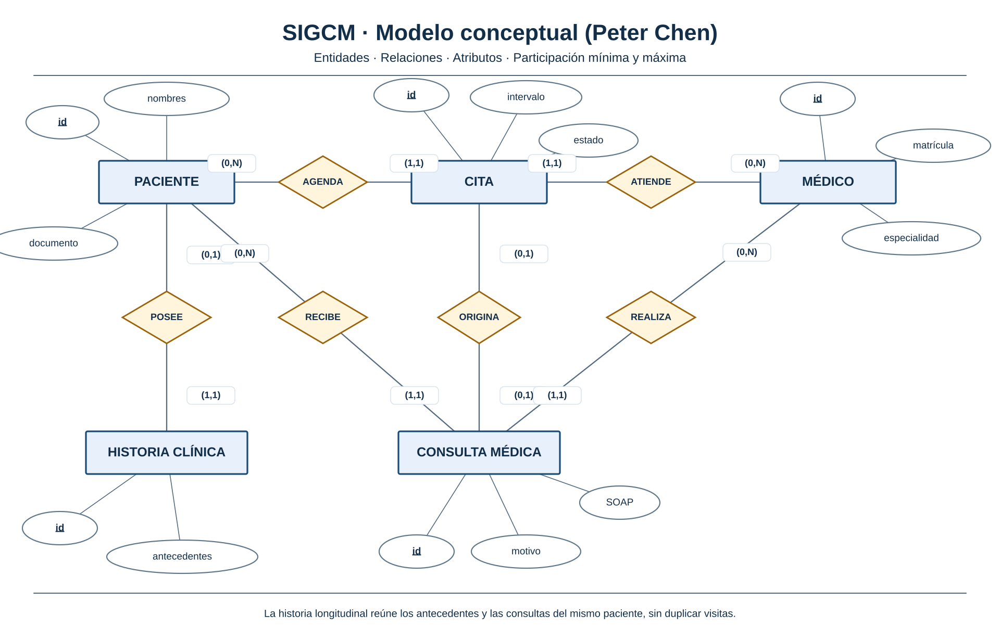
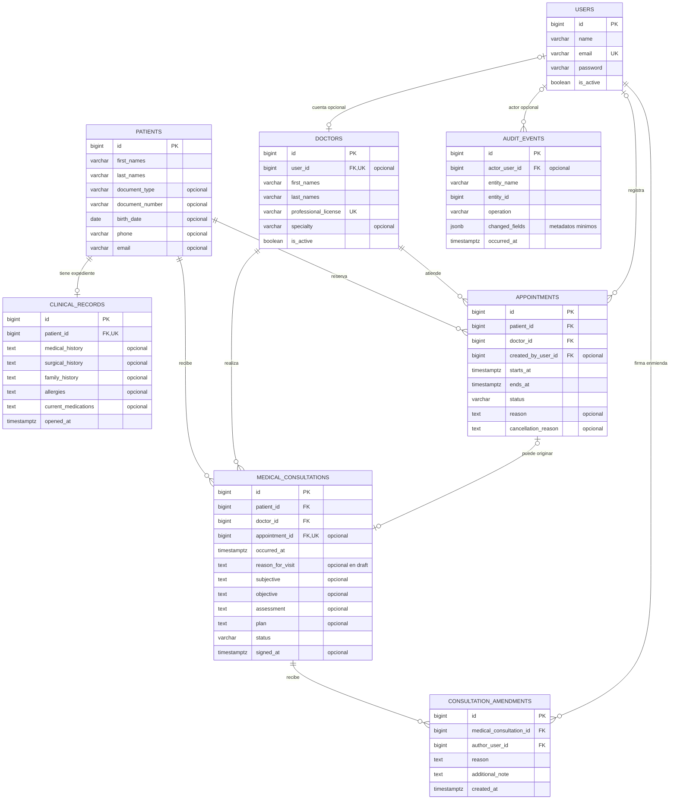

# SIGCM — Modelo entidad–relación v1

**Estado:** diseño propuesto · **Motor objetivo:** PostgreSQL 17 · **Alcance:** [README](../../README.md).  
**Referencia de ingeniería:** [clinic](https://github.com/walter-202/clinic) (no implica reutilizar su esquema).  
No se han creado migraciones ni tablas. El modelo se limita a un centro médico.

## 1. Modelo conceptual — notación de Peter Chen



[Ver diagrama vectorial](./diagramas/sigcm-chen-conceptual-v1.svg)

**Lectura:** rectángulo = entidad; rombo = relación; óvalo = atributo; identificador subrayado = clave; `(mín, máx)` = participación. Los cinco conceptos del alcance son **paciente, médico, cita, consulta médica e historia clínica**.

| Relación | Participación |
|---|---|
| Paciente — AGENDA — Cita | Paciente `(0,N)`; cita `(1,1)` |
| Médico — ATIENDE — Cita | Médico `(0,N)`; cita `(1,1)` |
| Paciente — POSEE — Historia clínica | Paciente `(0,1)`; historia `(1,1)` |
| Paciente — RECIBE — Consulta | Paciente `(0,N)`; consulta `(1,1)` |
| Médico — REALIZA — Consulta | Médico `(0,N)`; consulta `(1,1)` |
| Cita — ORIGINA — Consulta | Cita `(0,1)`; consulta `(0,1)` |

**Decisiones:** una cita puede cancelarse sin producir consulta; una consulta puede registrarse sin cita; el expediente reúne antecedentes y consultas del **mismo paciente**. La historia es opcional desde la cardinalidad de las tablas, pero se creará al registrar al paciente mediante una transacción.

## 2. Modelo lógico relacional — Mermaid ERD

El siguiente diagrama muestra las **tablas propias y las claves que se proyectan a PostgreSQL 17**. Es diferente del modelo conceptual de Chen.



**Convenciones:** `PK` clave primaria; `FK` clave foránea; `UK` unicidad. Campos opcionales marcados; se omiten `created_at` / `updated_at` repetitivos para conservar legibilidad. `AUDIT_EVENTS.entity_id` es un identificador genérico, **no** una FK a todas las entidades. La historia longitudinal se consulta por `patient_id`, sin duplicar las visitas en `clinical_records`.

### Diccionario resumido

| Tabla | Identificador y relaciones | Datos principales |
|---|---|---|
| `patients` | `id` PK; `(document_type, document_number)` UK | Identificación y contacto |
| `doctors` | `id` PK; `user_id` FK + UK opcional | Matrícula, nombres, especialidad |
| `clinical_records` | `id` PK; `patient_id` FK + UK | Antecedentes y alergias |
| `appointments` | `id` PK; `patient_id`, `doctor_id`, `created_by_user_id` FK | Inicio, fin, estado y motivo |
| `medical_consultations` | `id` PK; `patient_id`, `doctor_id` FK; `appointment_id` FK + UK opcional | Motivo, SOAP, firma |
| `consultation_amendments` | `id` PK; `medical_consultation_id`, `author_user_id` FK | Motivo y nota correctiva inmutable |
| `users` | `id` PK; `email` UK | Identidad autenticada |
| `audit_events` | `id` PK; `actor_user_id` FK opcional | Entidad, operación, instante, metadatos |

**Control de acceso:** Filament Shield usa los cinco conjuntos relacionales de Spatie (`roles`, `permissions`, `model_has_roles`, `model_has_permissions`, `role_has_permissions`). No agregar `users.role_id` ni una segunda estructura RBAC. El detalle de esos paquetes y de la infraestructura pertenece a otro documento.

## 3. Reglas de integridad — PostgreSQL 17

| Regla | Mecanismo |
|---|---|
| Identificador único de paciente si tiene documento | `UNIQUE(document_type, document_number)`; `CHECK` para ambos presentes o ambos nulos |
| Una historia por paciente | `UNIQUE(clinical_records.patient_id)` |
| Una consulta por cita, permitiendo consulta espontánea | `UNIQUE(medical_consultations.appointment_id)` con `NULL` permitido |
| Consulta y cita del mismo paciente/médico | FK compuesta `(appointment_id, patient_id, doctor_id)` hacia `appointments(id, patient_id, doctor_id)` con UK referenciable |
| Fin posterior al inicio | `CHECK (ends_at > starts_at)` |
| Estados permitidos | `CHECK` de estado en citas y consultas |
| Consulta firmada no modificable | Trigger `BEFORE UPDATE/DELETE`; corrección solo por enmienda |
| Citas simultáneas del mismo médico | Restricción `EXCLUDE USING gist` sobre `tstzrange` |
| Auditoría de cambios confirmados | Trigger `AFTER` y tabla propia `audit_events` |
| No perder historia por eliminación accidental | FKs `RESTRICT` / desactivación lógica, sin `CASCADE` sobre datos clínicos |

Restricción de ejemplo que se aplicará en una migración de PostgreSQL 17 (aún no ejecutada):

```sql
CREATE EXTENSION IF NOT EXISTS btree_gist;

ALTER TABLE appointments
  ADD CONSTRAINT appointments_time_valid CHECK (ends_at > starts_at),
  ADD CONSTRAINT appointments_no_doctor_overlap
  EXCLUDE USING gist (
    doctor_id WITH =,
    tstzrange(starts_at, ends_at, '[)') WITH &&
  )
  WHERE (status IN ('pending', 'confirmed', 'checked_in'));
```

El filtro de estados determina cuáles citas **ocupan horario**. Su definición debe verificarse con el flujo funcional; los registros históricos de citas completadas se conservan sin bloquear nuevas reservas. Los índices de búsquedas habituales se definirán a partir de consultas y `EXPLAIN (ANALYZE, BUFFERS)`, no por intuición.

## 4. Operaciones y trazabilidad

- **Alta del paciente:** transacción para crear `patients` y `clinical_records`.
- **Programación:** validaciones `CHECK/FK` + exclusión de solapamiento; la base rechaza conflictos concurrentes.
- **Atención:** la consulta registra los campos SOAP y puede referenciar una cita.
- **Firma:** `draft → signed`, con `signed_at`, motivo obligatorio y protección posterior contra modificación.
- **Enmienda:** inserción de nota correctiva en `consultation_amendments`, sin sobrescribir el registro firmado.
- **Auditoría:** trigger con instante, entidad, operación y actor; evitar duplicar información clínica sensible. Los `SELECT` no son auditados por triggers de tabla y necesitan control aparte si se exige auditoría de lectura.
- **Consultas frecuentes:** vistas SQL para agenda diaria e historial por paciente; funciones PL/pgSQL solo cuando aporten una operación reutilizable o una validación que no pueda expresarse declarativamente.

**Pendiente de validación:** atención sin cita, cambios de estado permitidos, firma clínica, política de retención, consentimiento, responsables de acceso y prohibición de horarios simultáneos para un mismo paciente. Los detalles de instalación de Laravel/Filament, servicios, caché y colas se documentarán por separado.

**Base técnica:** [Restricciones PostgreSQL 17](https://www.postgresql.org/docs/17/ddl-constraints.html) · [Rangos PostgreSQL 17](https://www.postgresql.org/docs/17/rangetypes.html).
