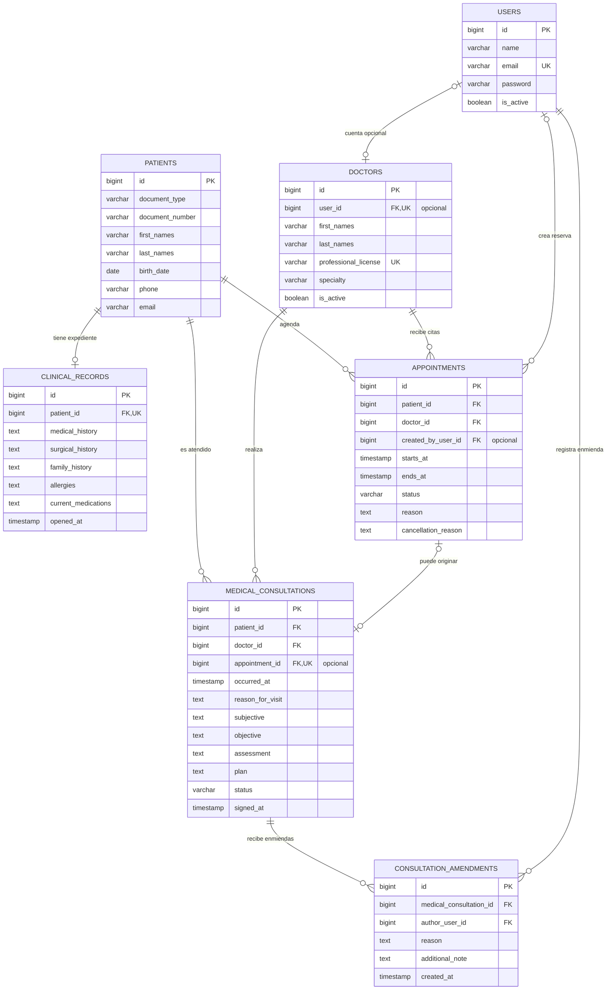
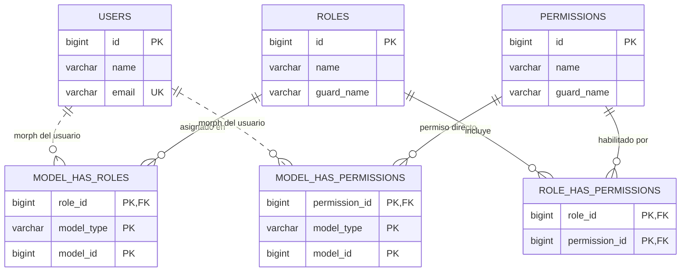

# SIGCM — Modelo Entidad–Relación v1 (propuesta)

**Estado:** Propuesto, pendiente de validación funcional.  
**Fecha del diseño original:** 2026-11-02; **actualización Mermaid/Shield:** 2026-11-06.  
**Fuente de alcance:** [README de SIGCM](../../README.md), en su versión de `main` consultada el 2026-11-02.  
**Referencia técnica comparativa:** [walter-202/clinic](https://github.com/walter-202/clinic) (no se replica su esquema ni se asume que sus módulos son parte de SIGCM).  
**Importante:** Este documento describe un modelo objetivo; SIGCM aún no contiene migraciones ni modelos Laravel.

## 1. Alcance y lenguaje ubicuo

El README compromete exactamente cinco capacidades funcionales:
1. Pacientes.
2. Médicos.
3. Citas.
4. Consultas médicas.
5. Historias clínicas.

Se adopta un **monolito modular Laravel + PostgreSQL** para una sola institución inicialmente. No se presupone multi-clínica, inventarios, facturación, recetas electrónicas, colas de espera, integraciones, inteligencia artificial, seguros ni agendas de múltiples consultorios: nada de eso aparece en el alcance aprobado.

**Glosario**
- **Paciente:** persona a quien se brinda atención.
- **Médico:** profesional responsable de una consulta o cita.
- **Cita:** reserva administrativa de un intervalo futuro. Una cita puede cancelarse o no llegar a generar atención.
- **Consulta médica:** acto clínico realmente documentado, que puede originarse en una cita o registrarse sin cita previa.
- **Historia clínica:** expediente longitudinal único por paciente, compuesto por antecedentes persistentes y el historial cronológico de consultas. La tabla `clinical_records` almacena los antecedentes; no duplica las consultas.

## 2. Modelo entidad–relación: conceptual Chen + lógico Mermaid

### 2.1. Modelo conceptual — Peter Chen


**Notación:** entidades en rectángulos; relaciones en rombos; atributos en óvalos; identificadores subrayados. Las etiquetas `(mínimo,máximo)` muestran la participación de cada entidad en la relación. La relación **REÚNE** figura con líneas discontinuas porque la colección de consultas de la historia se **deriva de `patient_id`**, sin introducir una FK adicional en `medical_consultations`.

- [Abrir el diagrama vectorial SVG](./diagramas/sigcm-chen-conceptual-v1.svg).
- **Modelo conceptual vs. físico:** el diagrama representa los cinco dominios del README. Las entidades técnicas `users` y `consultation_amendments` se mantienen en el diccionario lógico de este documento, sin mezclarse con el alcance conceptual de negocio.
- **Participación:** `PACIENTE (1,1) — POSEE — (1,1) HISTORIA CLÍNICA` asume el alta transaccional de ambos registros indicada por RI-01. Antes del alta, no existe ninguno de los dos.


### 2.2. Modelo lógico relacional — Mermaid

El siguiente **ERD implementable** complementa a Peter Chen: aquí aparecen tablas, columnas PK/FK y relaciones que posteriormente se llevarán a migraciones Laravel/PostgreSQL. No implica que estas tablas ya existan en SIGCM.



**Criterios de lectura:** el diagrama distingue el vínculo físico (FK) de la derivación lógica. La **historia clínica longitudinal** se reconstruye combinando `clinical_records` con las consultas del mismo paciente; no se crea una FK adicional `clinical_record_id` en `medical_consultations`. Los timestamps operacionales de citas y consultas se proyectan como `timestamptz` en PostgreSQL. `password` corresponde al hash de contraseña que maneja Laravel, nunca a una contraseña en texto claro.

**Ajustes relacionales:** `PATIENTS → CLINICAL_RECORDS` se modela 1:0..1 por integridad de la tabla (FK única), aunque el caso de uso registrará ambos en una sola transacción para que normalmente exista 1:1. `APPOINTMENTS ↔ MEDICAL_CONSULTATIONS` es opcional en ambos extremos: se permite atención sin cita y una cita puede no generar consulta. La FK opcional de cuenta de acceso en `DOCTORS` no representa el rol: los roles viven en Spatie.

### 2.3. Autorización — Filament Shield + Spatie (Mermaid)

**Decisión tecnológica:** usar **Filament para la interfaz administrativa/clínica**, **Filament Shield** para gestionar y generar capacidades/permisos de componentes Filament, y **`spatie/laravel-permission` como fuente de verdad de roles y permisos**. Shield no sustituye a Spatie ni necesita una tabla propia de roles. Para SIGCM v1 proponemos **un único panel de personal**, sin multi-tenancy ni `teams` de Spatie.



**Alcance del diagrama RBAC:** las líneas discontinuas hacia `USERS` indican asociación **polimórfica**, no una FK SQL real de `model_id` hacia `users.id`; `model_type` resuelve el tipo del modelo. En esta aplicación se prevé emplear la entidad autorizable `App\\Models\\User` (`HasRoles`). Las tres tablas pivote y las tablas `roles`/`permissions` pertenecen a la migración publicada de Spatie: **no recrearlas manualmente**, no crear `users.role_id`, `doctor_role_id` ni tablas paralelas `user_roles`. La clave compuesta de cada pivote es la especificada en el diagrama para configuración `teams=false`; la opción `teams=true` alteraría parte de las PK y queda fuera del alcance de v1.

**Permisos de ejemplo, sujetos al formato de claves configurado en Shield:** `view_any_patient`, `view_patient`, `create_patient`, `update_patient`, `view_any_appointment`, `create_appointment`, `view_medical_consultation`, `create_medical_consultation` y permisos explícitos de negocio como `sign_consultation` o `amend_signed_consultation`. Los dos últimos son **acciones personalizadas**: requieren política/caso de uso propio y no se consideran generadas automáticamente por Shield.

| Rol candidato | Pacientes | Citas | Consultas e historia clínica |
|---|---|---|---|
| `admin` | Administración de datos demográficos | Gestión administrativa | Acceso clínico no implícito: conceder solo si hay necesidad autorizada |
| `medico` | Lectura de pacientes que puede atender | Citas asignadas | Registrar y firmar sus atenciones; acceso contextual a expedientes autorizados |
| `recepcionista` | Alta y actualización demográfica | Registrar, confirmar y cancelar según política | Sin acceso a notas clínicas por defecto |

Esta matriz es **propuesta de permisos**, no roles ya implementados. Distinguir **permiso para una acción** (`can()` / Policies) de **alcance de registros** (consultas filtradas por médico/paciente autorizado); un permiso global de `viewAny()` no debe filtrar automáticamente de manera demasiado amplia ni permitir lecturas directas de un registro ajeno. Proteger las acciones también en el servidor: ocultar botones de Filament no es autorización suficiente.

**Configuración mínima prevista:** `User` aplica `HasRoles`; el panel usa una política explícita de acceso (`canAccessPanel`) y un guard consistente (inicialmente `web`). Las políticas de `Patient`, `Appointment`, `MedicalConsultation` y `ClinicalRecord` aplican reglas por registro. Generación de permisos Shield y seeder de roles deben ser **reproducibles e idempotentes**; antes de ejecutar regeneraciones masivas, revisar políticas personalizadas para no sobrescribir reglas clínicas.

**Fuentes técnicas:** [Filament Shield](https://github.com/bezhanSalleh/filament-shield), [Spatie Laravel Permission — migración y tablas](https://github.com/spatie/laravel-permission/blob/main/database/migrations/create_permission_tables.php.stub), [documentación de Shield de `clinic`](https://github.com/walter-202/clinic/blob/main/docs/shield-permissions.md).

### 2.4. Cardinalidades y opcionalidad


`PK` = primary key; `FK` = foreign key; `UK` = clave única. Las columnas `created_at` y `updated_at` convencionales se omiten del diagrama para mejorar su lectura. En `patients`, la unicidad es **compuesta** entre `document_type` y `document_number` cuando ambos se conocen, no individual por campo.


| Relación | Cardinalidad | Justificación |
|---|---|---|
| Paciente — historia clínica | 1 — 0..1 | Crear expediente junto al paciente en una transacción; `clinical_records.patient_id` es `UNIQUE NOT NULL`. |
| Paciente — cita | 1 — 0..N | Puede registrarse antes de reservar. |
| Médico — cita | 1 — 0..N | Un médico atiende muchas citas, pero no debe solapar intervalos activos. |
| Paciente — consulta | 1 — 0..N | Soporta longitudinalidad clínica. |
| Médico — consulta | 1 — 0..N | Identifica la responsabilidad profesional. |
| Cita — consulta | 0..1 — 0..1 | Un acto clínico por cita; consulta sin cita válida; cita cancelada sin consulta. `appointment_id` es `UNIQUE NULLABLE`. |
| Consulta — enmienda | 1 — 0..N | Correcciones posteriores a firma sin sobrescribir originales. |
| Usuario — médico | 0..1 — 0..1 | `doctors.user_id` es opcional y único: identidad profesional distinta de credencial de acceso. |

### 2.5. Modelo lógico tabular — esquema relacional completo

**Estado:** propuesta de esquema normalizado (no implementado). Se detalla la traducción de las entidades y las asociaciones a **12 tablas**: siete tablas de SIGCM/Laravel (seis de operación y `users`) y cinco tablas administradas por Spatie. Filament Shield utiliza ese RBAC, **sin crear tablas propias de roles o permisos**.

| Grupo | Tablas | Propietario del esquema |
|---|---|---|
| Operacional | `patients`, `doctors`, `clinical_records`, `appointments`, `medical_consultations`, `consultation_amendments` | Migraciones de SIGCM |
| Identidad | `users` | Migraciones de autenticación Laravel, adaptadas al proyecto |
| Autorización | `roles`, `permissions`, `role_has_permissions`, `model_has_roles`, `model_has_permissions` | Migraciones oficiales de Spatie (`teams=false`) |

**Convenciones:** `PK` = clave primaria; `FK` = clave foránea; `UK` = unicidad; `NULL` = valor opcional. Los tipos PostgreSQL recomendados son orientativos hasta definir las migraciones. Los campos agrupados con coma representan columnas independientes del mismo tipo y nulabilidad. `created_at/updated_at` reflejan convenciones de Laravel, pero los paquetes externos pueden ajustar sus definiciones según su versión instalada.

#### `users` — Identidades y acceso

**Responsable:** Laravel / aplicación.

| Campo | Tipo propuesto | ¿NULL? | Regla / finalidad |
|---|---|---|---|
| `id` | `BIGINT` | No | PK |
| `name` | `VARCHAR(150)` | No | Nombre visible del usuario |
| `email` | `VARCHAR(255)` | No | UK; correo normalizado |
| `password` | `VARCHAR(255)` | No | Hash generado por Laravel; nunca texto claro |
| `is_active` | `BOOLEAN` | No | DEFAULT true |
| `created_at, updated_at` | `TIMESTAMPTZ` | Sí | Metadatos convencionales de Laravel |

**Restricciones / índices:**
- Un usuario puede existir sin ser médico.
- No crear `role_id` en `users`; usar tablas Spatie.
- Desactivar cuentas en lugar de borrar identidades históricas.

#### `doctors` — Médicos

**Responsable:** SIGCM.

| Campo | Tipo propuesto | ¿NULL? | Regla / finalidad |
|---|---|---|---|
| `id` | `BIGINT` | No | PK |
| `user_id` | `BIGINT` | Sí | FK → `users.id`, UK; cuenta opcional |
| `first_names, last_names` | `VARCHAR(150)` | No | Nombre legal/profesional |
| `professional_license` | `VARCHAR(70)` | No | UK; matrícula / registro profesional |
| `specialty` | `VARCHAR(150)` | Sí | Descriptor inicial, no catálogo M:N |
| `is_active` | `BOOLEAN` | No | DEFAULT true |
| `created_at, updated_at` | `TIMESTAMPTZ` | Sí | Metadatos |

**Restricciones / índices:**
- `user_id` no determina rol ni permiso; la identidad profesional es independiente.
- Médico inactivo conserva consultas históricas, pero no admite nuevas reservas.

#### `patients` — Pacientes

**Responsable:** SIGCM.

| Campo | Tipo propuesto | ¿NULL? | Regla / finalidad |
|---|---|---|---|
| `id` | `BIGINT` | No | PK |
| `document_type` | `VARCHAR(20)` | Sí | Tipo de identificación |
| `document_number` | `VARCHAR(60)` | Sí | Número de identificación |
| `first_names, last_names` | `VARCHAR(150)` | No | Nombre del paciente |
| `birth_date` | `DATE` | Sí | Fecha de nacimiento, sin edad redundante |
| `phone` | `VARCHAR(40)` | Sí | Contacto |
| `email` | `VARCHAR(255)` | Sí | Contacto |
| `created_at, updated_at` | `TIMESTAMPTZ` | Sí | Metadatos |

**Restricciones / índices:**
- UK compuesta `(document_type, document_number)`; no exigir documento al crear paciente.
- CHECK: ambos campos del documento nulos o ambos presentes.
- No almacenar diagnósticos, tratamientos ni notas clínicas en esta tabla.

#### `clinical_records` — Historias clínicas

**Responsable:** SIGCM.

| Campo | Tipo propuesto | ¿NULL? | Regla / finalidad |
|---|---|---|---|
| `id` | `BIGINT` | No | PK |
| `patient_id` | `BIGINT` | No | FK → `patients.id`; UK para 1:1 |
| `medical_history` | `TEXT` | Sí | Antecedentes patológicos |
| `surgical_history` | `TEXT` | Sí | Antecedentes quirúrgicos |
| `family_history` | `TEXT` | Sí | Antecedentes familiares |
| `allergies` | `TEXT` | Sí | Alergias |
| `current_medications` | `TEXT` | Sí | Medicación habitual |
| `opened_at` | `TIMESTAMPTZ` | No | Fecha de apertura del expediente |
| `created_at, updated_at` | `TIMESTAMPTZ` | Sí | Metadatos |

**Restricciones / índices:**
- Crear expediente conjuntamente con el paciente en una sola transacción.
- El detalle cronológico de visitas reside en `medical_consultations`; no duplicarlo aquí.

#### `appointments` — Citas

**Responsable:** SIGCM.

| Campo | Tipo propuesto | ¿NULL? | Regla / finalidad |
|---|---|---|---|
| `id` | `BIGINT` | No | PK |
| `patient_id` | `BIGINT` | No | FK → `patients.id` |
| `doctor_id` | `BIGINT` | No | FK → `doctors.id` |
| `created_by_user_id` | `BIGINT` | Sí | FK → `users.id`, para reservas manuales o externas |
| `starts_at, ends_at` | `TIMESTAMPTZ` | No | Intervalo `[inicio, fin)` |
| `status` | `VARCHAR(20)` | No | pending / confirmed / checked_in / completed / cancelled / no_show |
| `reason` | `TEXT` | Sí | Motivo administrativo |
| `cancellation_reason` | `TEXT` | Sí | Motivo de cancelación |
| `created_at, updated_at` | `TIMESTAMPTZ` | Sí | Metadatos |

**Restricciones / índices:**
- CHECK `ends_at > starts_at` y status en catálogo permitido.
- UK `(id,patient_id,doctor_id)` necesaria para FK compuesta de consultas.
- En PostgreSQL, EXCLUDE sobre médico + `tstzrange` para impedir solapamiento de citas no canceladas.
- Índices `(doctor_id, starts_at)`, `(patient_id, starts_at DESC)`.

#### `medical_consultations` — Consultas médicas

**Responsable:** SIGCM.

| Campo | Tipo propuesto | ¿NULL? | Regla / finalidad |
|---|---|---|---|
| `id` | `BIGINT` | No | PK |
| `patient_id` | `BIGINT` | No | FK → `patients.id` |
| `doctor_id` | `BIGINT` | No | FK → `doctors.id` |
| `appointment_id` | `BIGINT` | Sí | FK → `appointments.id`; UK, permite atención sin cita |
| `occurred_at` | `TIMESTAMPTZ` | No | Momento real de la atención |
| `reason_for_visit` | `TEXT` | Sí | Obligatorio antes de firmar |
| `subjective, objective` | `TEXT` | Sí | SOAP: síntomas y hallazgos |
| `assessment, plan` | `TEXT` | Sí | SOAP: evaluación y plan |
| `status` | `VARCHAR(15)` | No | draft / signed |
| `signed_at` | `TIMESTAMPTZ` | Sí | No nulo cuando está firmada |
| `created_at, updated_at` | `TIMESTAMPTZ` | Sí | Metadatos |

**Restricciones / índices:**
- UK `appointment_id` (permite múltiples NULL en PostgreSQL).
- FK compuesta `(appointment_id,patient_id,doctor_id)` → `appointments(id,patient_id,doctor_id)` para coherencia de citas.
- CHECK `(status='draft' AND signed_at IS NULL) OR (status='signed' AND signed_at IS NOT NULL)`.
- No sobrescribir consultas firmadas; únicamente anexar correcciones.

#### `consultation_amendments` — Enmiendas clínicas

**Responsable:** SIGCM.

| Campo | Tipo propuesto | ¿NULL? | Regla / finalidad |
|---|---|---|---|
| `id` | `BIGINT` | No | PK |
| `medical_consultation_id` | `BIGINT` | No | FK → `medical_consultations.id` |
| `author_user_id` | `BIGINT` | No | FK → `users.id` |
| `reason` | `TEXT` | No | Motivo justificativo |
| `additional_note` | `TEXT` | No | Contenido de la corrección |
| `created_at` | `TIMESTAMPTZ` | No | Fecha inmutable de la enmienda |

**Restricciones / índices:**
- Solo crear enmiendas para consultas firmadas.
- No `UPDATE` ni `DELETE` ordinario; mantener autor y marca temporal verificables.
- Índice `(medical_consultation_id, created_at)`.

#### `roles` — Autorización

**Responsable:** Spatie Laravel Permission.

| Campo | Tipo propuesto | ¿NULL? | Regla / finalidad |
|---|---|---|---|
| `id` | `BIGINT` | No | PK |
| `name` | `VARCHAR(255)` | No | Nombre del rol: admin, medico, recepcionista |
| `guard_name` | `VARCHAR(255)` | No | Guard esperado: web |
| `created_at, updated_at` | `TIMESTAMPTZ` | Sí | Según migración del paquete |

**Restricciones / índices:**
- UK `(name, guard_name)` con `teams=false`.
- La tabla la genera Spatie; **no** crear migración propia duplicada.

#### `permissions` — Autorización

**Responsable:** Spatie Laravel Permission.

| Campo | Tipo propuesto | ¿NULL? | Regla / finalidad |
|---|---|---|---|
| `id` | `BIGINT` | No | PK |
| `name` | `VARCHAR(255)` | No | Capacidad generada por Shield o personalizada |
| `guard_name` | `VARCHAR(255)` | No | Guard esperado: web |
| `created_at, updated_at` | `TIMESTAMPTZ` | Sí | Según migración del paquete |

**Restricciones / índices:**
- UK `(name, guard_name)`.
- Firmar o enmendar consultas requiere permisos de negocio explícitos y Policies además de permisos Shield.

#### `role_has_permissions` — Autorización

**Responsable:** Spatie Laravel Permission.

| Campo | Tipo propuesto | ¿NULL? | Regla / finalidad |
|---|---|---|---|
| `permission_id` | `BIGINT` | No | PK compuesta, FK → `permissions.id` |
| `role_id` | `BIGINT` | No | PK compuesta, FK → `roles.id` |

**Restricciones / índices:**
- PK compuesta `(permission_id, role_id)` y sin columna `id` adicional.
- Implementa N:M entre roles y permisos.

#### `model_has_roles` — Autorización

**Responsable:** Spatie Laravel Permission.

| Campo | Tipo propuesto | ¿NULL? | Regla / finalidad |
|---|---|---|---|
| `role_id` | `BIGINT` | No | PK compuesta, FK → `roles.id` |
| `model_type` | `VARCHAR(255)` | No | PK compuesta, clase autorizable |
| `model_id` | `BIGINT` | No | PK compuesta, identificador de modelo (usualmente `users.id`) |

**Restricciones / índices:**
- PK compuesta `(role_id,model_id,model_type)` con `teams=false`.
- `model_id` + `model_type` es una relación polimórfica, no una FK SQL hacia `users`.

#### `model_has_permissions` — Autorización

**Responsable:** Spatie Laravel Permission.

| Campo | Tipo propuesto | ¿NULL? | Regla / finalidad |
|---|---|---|---|
| `permission_id` | `BIGINT` | No | PK compuesta, FK → `permissions.id` |
| `model_type` | `VARCHAR(255)` | No | PK compuesta, clase autorizable |
| `model_id` | `BIGINT` | No | PK compuesta, identificador del modelo |

**Restricciones / índices:**
- PK compuesta `(permission_id,model_id,model_type)` con `teams=false`.
- Usar concesiones directas solo cuando exista una justificación; preferir roles y Policies.

### 2.6. Integridad referencial y decisiones de normalización

| Relación / dependencia | Clave(s) | Cardinalidad | Acción propuesta al eliminar |
|---|---|---|---|
| Paciente → historia | `clinical_records.patient_id` | 1:0..1 (1:1 mediante alta transaccional) | `RESTRICT` |
| Paciente → citas | `appointments.patient_id` | 1:N | `RESTRICT` |
| Médico → citas | `appointments.doctor_id` | 1:N | `RESTRICT` |
| Paciente → consultas | `medical_consultations.patient_id` | 1:N | `RESTRICT` |
| Médico → consultas | `medical_consultations.doctor_id` | 1:N | `RESTRICT` |
| Cita → consulta | `medical_consultations.appointment_id` | 0..1:0..1 | `RESTRICT` |
| Consulta → enmiendas | `consultation_amendments.medical_consultation_id` | 1:N | `RESTRICT` |
| Usuario → médico | `doctors.user_id` | 0..1:0..1 | `RESTRICT` o desactivación de cuenta |
| Usuario → cita creada | `appointments.created_by_user_id` | 1:N opcional | `RESTRICT` o desactivación de cuenta |
| Usuario → enmienda | `consultation_amendments.author_user_id` | 1:N | `RESTRICT` |
| Roles ↔ permisos | `role_has_permissions` | N:M | Cascade sobre pivote **del paquete** |
| Roles / permisos ↔ modelo | `model_has_roles`, `model_has_permissions` | N:M polimórfica | Gestión por Spatie; sin FK física a `users` |

**3FN / normalización**:

1. `medical_consultations` no repite antecedentes de `clinical_records`; cada consulta registra hechos de un instante clínico específico.
2. Edad no se almacena: se calcula desde `patients.birth_date`; ninguna lista de consultas se guarda serializada en el expediente.
3. Las relaciones N:M de autorización usan tablas pivote estándar, evitando campos multivaluados y roles duplicados.
4. `doctors.user_id` vincula la identidad profesional con una credencial opcional; `users` no almacena especialidad ni matrícula.
5. `appointments` y `medical_consultations` tienen ciclos de vida independientes; una consulta espontánea tiene `appointment_id = NULL`.

**Restricciones que requieren implementar más que claves:** una FK no verifica que un médico esté activo, que una cita esté en estado compatible ni que una consulta firmada sea inmutable; esos invariantes exigen casos de uso transaccionales y, para garantías resistentes a escrituras fuera de la aplicación, políticas de escritura/trigger PostgreSQL según la criticidad validada. La exclusión de solapamientos se describe en el capítulo 4.

**Filament Shield:** no hay una tabla `filament_shield`, ni se necesita `user_roles`. Shield administra permisos mediante Spatie. En el entorno real se debe instalar/publicar la migración de la versión de `spatie/laravel-permission` seleccionada, no copiar manualmente estas definiciones de referencia.

**Límite del modelo:** no se incluyen consultorios, especialidades normalizadas, órdenes clínicas, pagos, resultados de laboratorio o multi-sede: requieren aprobar nuevos casos de uso.

## 3. Diccionario de entidades

### 3.1. `patients`
- Datos mínimos: `id`, `first_names`, `last_names`, documento (tipo y número opcionales), nacimiento y medios de contacto opcionales, timestamps.
- `UNIQUE(document_type, document_number)`; normalizar espacios y formato antes de persistir; **sin asumir documento para todos los pacientes**.
- No almacenar diagnósticos ni antecedentes clínicos repetidos en esta tabla.
- Borrado de datos clínicos: **no** usar cascadas desde pacientes.

### 3.2. `doctors`
- `id`, nombre, registro profesional (sujeto a validación de formato y unicidad), especialidad descriptiva y activo.
- `user_id` opcional y único: permite registrar médicos antes de habilitar cuentas.
- No duplicar autorización en `doctors`: acceso/autenticación son responsabilidad de `users`.

### 3.3. `appointments`
- `id`, paciente, médico, inicio y fin (ambos `timestamptz`), estado, motivo y cancelación, autor opcional.
- Estados iniciales propuestos: `pending`, `confirmed`, `checked_in`, `completed`, `cancelled`, `no_show`.
- Intervalos semiabiertos `[inicio, fin)` para permitir citas contiguas sin falso conflicto.
- `CHECK (ends_at > starts_at)`. El tiempo se persiste como instante con zona; presentar en la zona configurada del centro.
- Índices: `(doctor_id, starts_at)`, `(patient_id, starts_at DESC)` y exclusión de solapamiento bajo la misma condición de vigencia.
- Prohibir asignar nuevas citas a médico inactivo.

### 3.4. `clinical_records`
- Una sola fila de antecedentes longitudinales por paciente; columnas clínicas de texto editables bajo permisos y auditoría.
- `patient_id` es `NOT NULL UNIQUE`.
- La **vista de historia clínica completa** combina `patients` + `clinical_records` + `medical_consultations` (ordenadas cronológicamente). No se duplica `patient_id` ni se almacena un arreglo JSON de consultas dentro del expediente.

### 3.5. `medical_consultations`
- `patient_id` y `doctor_id` requeridos; `appointment_id` opcional y único.
- `reason_for_visit` requerido al firmar; los campos SOAP (`subjective`, `objective`, `assessment`, `plan`) permiten documentación clínica estructurada sin agregar módulos no aprobados.
- Estados mínimos: `draft` y `signed`; `signed_at` se fija al firmar.
- Una consulta `signed` no puede editarse ni borrarse: se corrige mediante `consultation_amendments`.
- Validación transaccional: si existe cita, esta debe corresponder exactamente al mismo paciente y médico y no estar cancelada. Para endurecimiento en PostgreSQL se recomienda FK compuesta `(appointment_id, patient_id, doctor_id)` hacia un índice único de `appointments(id, patient_id, doctor_id)`; se implementará durante las migraciones, no se presume implementado.

### 3.6. `consultation_amendments`
- `medical_consultation_id`, `author_user_id`, `reason`, `additional_note`, `created_at`.
- Fila de solo anexado; no modificar ni eliminar enmiendas existentes.
- Es infraestructura mínima de integridad de documentación clínica, **no** un módulo adicional de negocio.

### 3.7. `users` y RBAC con Filament Shield
- Identidades de inicio de sesión: nombre, correo único, hash de contraseña, estado y timestamps.
- Autenticación con Laravel; autorización con Spatie Permission (`HasRoles` en `User`) y Filament Shield como capa de administración/generación de permisos.
- Los roles son asignaciones M:N mediante `model_has_roles`, no una columna `users.role_id`. Un médico puede tener una cuenta opcional `doctors.user_id`; esa relación no concede privilegios por sí misma.
- Roles iniciales candidatos: `admin`, `medico`, `recepcionista`. Aplicar permisos y *Policies* por entidad, verificando también que el profesional esté autorizado para cada paciente/cita/consulta.
- Mantener `guard_name` coherente con el guard de autenticación elegido. No activar `teams` ni multi-tenancy sin requisitos aprobados.

## 4. Reglas de integridad y concurrencia (invariantes)

**RI-01.** Cada historia clínica pertenece a un solo paciente, con relación 1:1 efectiva creada al registrar un paciente.  
**RI-02.** Cada cita referencia un paciente y un médico válidos.  
**RI-03.** Citas no canceladas de un mismo médico no pueden solaparse, incluso cuando dos operadores intentan reservar concurrentemente.  
**RI-04.** El intervalo de una cita es estrictamente positivo.  
**RI-05.** La consulta puede carecer de cita (atención espontánea), pero una misma cita no puede originar dos consultas.  
**RI-06.** Cuando la consulta tiene cita, paciente y médico deben coincidir con los de la cita.  
**RI-07.** La historia se obtiene de antecedentes más consultas; nunca duplicar la narración de una visita en ambas tablas.  
**RI-08.** Ningún borrado en cascada debe eliminar datos clínicos históricos.  
**RI-09.** Una consulta firmada es inmutable; toda corrección posterior requiere enmienda trazable.  
**RI-10.** Acceso a información sensible requiere políticas de autorización, auditoría y minimización de los datos expuestos.  
**RI-11.** Filament Shield/Spatie determina **qué acciones** puede ejecutar un usuario; las políticas y consultas filtradas determinan **sobre qué registros** puede operar. El personal de recepción no puede acceder a narrativas clínicas sin una concesión explícita.  
**RI-12.** No se crea `users.role_id` ni se duplica el esquema de roles/permisos de Spatie. La relación `doctors.user_id` no confiere permisos automáticamente.

### Exclusión de solapamiento en PostgreSQL (propuesta física, no migración ejecutada)

```sql
CREATE EXTENSION IF NOT EXISTS btree_gist;

ALTER TABLE appointments
  ADD CONSTRAINT appointments_valid_interval
  CHECK (ends_at > starts_at);

ALTER TABLE appointments
  ADD CONSTRAINT appointments_no_doctor_overlap
  EXCLUDE USING gist (
    doctor_id WITH =,
    tstzrange(starts_at, ends_at, '[)') WITH &&
  )
  WHERE (status <> 'cancelled');
```

Aplicar en una migración PostgreSQL mediante `DB::statement(...)` cuando exista el esqueleto Laravel. **No basta con una consulta previa `SELECT`**, porque dos peticiones simultáneas pueden leer disponibilidad y reservar el mismo intervalo. Capturar `SQLSTATE 23P01` y comunicar un conflicto de horario. Para pacientes simultáneos se recomienda además una exclusión por `patient_id` con el mismo rango (pendiente de validación del negocio).

## 5. Flujos transaccionales

1. **Registrar paciente**: validar identificación; insertar `patients` y su `clinical_records` en una única transacción.
2. **Programar cita**: validar médico y paciente; verificar reglas de estado; insertar cita. La base de datos rechaza intervalos de médico solapados; la aplicación convierte el conflicto en error entendible.
3. **Registrar consulta**: crear `medical_consultations` para un paciente/médico, con cita opcional. Si hay cita, exigir concordancia de identidades y estado compatible.
4. **Firmar consulta**: comprobar mínimos clínicos, autorizar médico, fijar estado y momento de firma en una transacción. Una cita puede marcarse completada como parte del mismo caso de uso.
5. **Consultar historia**: buscar expediente por paciente e incluir consultas firmadas cronológicamente con eventuales enmiendas, sin exponer datos a usuarios no autorizados.

## 6. Arquitectura de aplicación sugerida

Monolito modular, sin microservicios. Separar por responsabilidad:

```text
app/
  Domain/
    Patients/
    Doctors/
    Scheduling/
    Consultations/
    ClinicalRecords/
  Application/
    Patients/RegisterPatient.php
    Scheduling/BookAppointment.php
    Consultations/RecordConsultation.php
    Consultations/SignConsultation.php
  Policies/                # control de acceso por recurso e instancia
  Filament/
    Resources/             # Pacientes, Medicos, Citas, Consultas, Historia
    Pages/                 # panel de personal
  Http/
database/
  migrations/
  factories/
  seeders/
tests/
  Feature/
  Unit/
```

Este árbol es **propuesta**, no estructura actual del repositorio. Mantener invariantes transaccionales en casos de uso/servicios, no en componentes Filament ni controladores de gran tamaño. **Filament será la interfaz de gestión prevista, y Shield/Spatie la infraestructura RBAC**; Eloquent aporta persistencia y relaciones, mientras las exclusiones e índices corresponden a PostgreSQL. No agregar microservicios, SPA paralela, múltiples paneles o multitenancy sin justificación de alcance.

## 7. Aceptación del diseño antes de implementar migraciones

- [ ] Entidades y cardinalidades aceptadas por responsable funcional.
- [ ] Decisión sobre atención sin cita.
- [ ] Decisión sobre una sola historia longitudinal por paciente.
- [ ] Definir estados de cita y transiciones válidas.
- [ ] Definir si la misma persona puede tener citas simultáneas con médicos distintos.
- [ ] Validar roles `admin`, `medico` y `recepcionista`, permisos Shield específicos y políticas por registro, además de quién puede registrar, ver, firmar y corregir información clínica.
- [ ] Validar un único panel de personal, guard `web` y Spatie `teams=false` para el MVP.
- [ ] Verificar en QA que esconder un botón no permite ejecutar la acción por URL, API o Livewire y que el médico no accede a expedientes ajenos.
- [ ] Cerrar campos clínicos mínimos obligatorios y conservación/auditoría de registros.
- [ ] Confirmar si SIGCM es para una sola institución; no asumir multi-tenancy.
- [ ] Escribir tests: cardinalidad, consultas sin cita, citas duplicadas en concurrencia, FK de identidad y correcciones post-firma.

## 8. Fuera del alcance actual (sin migraciones)

Catálogo de servicios, especialidades M:N, salas y sillas, disponibilidad recurrente, farmacia, inventarios, seguros, pagos, SIAT, facturación, multi-clínica, IA, MCP, telemedicina, integraciones de calendario, prescripciones y órdenes. Evaluar solo ante requisitos aprobados.

**Fundamentos:** [PostgreSQL — rangos y exclusiones](https://www.postgresql.org/docs/current/rangetypes.html); [Laravel 13 — migraciones e integridad referencial](https://laravel.com/docs/13.x/migrations).
